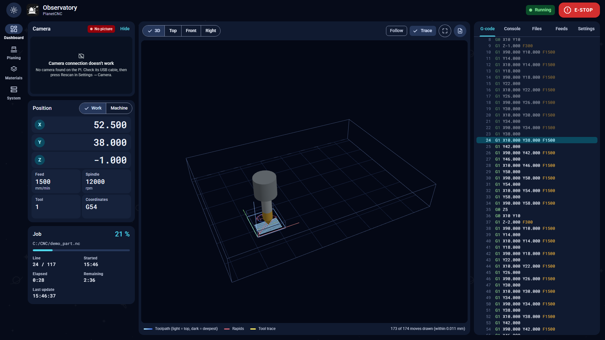
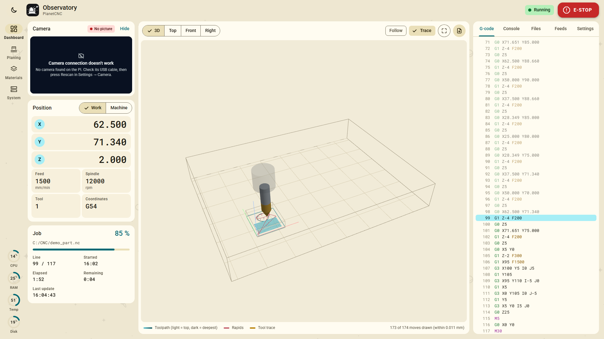
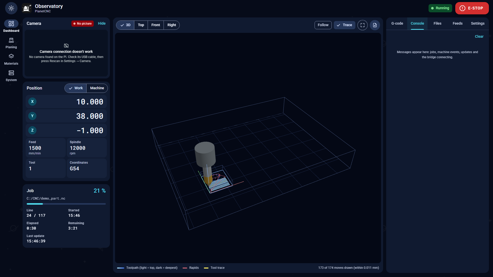
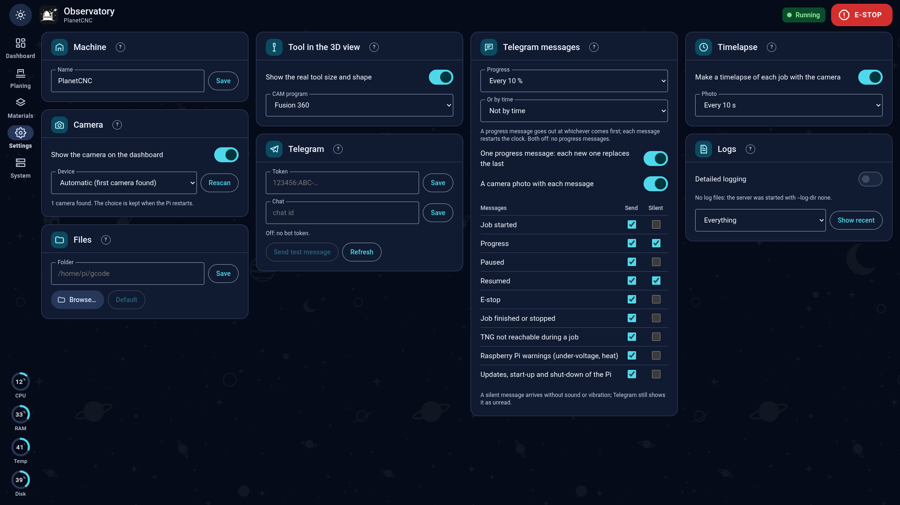
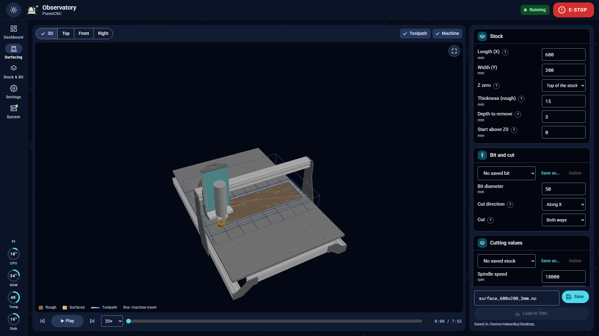
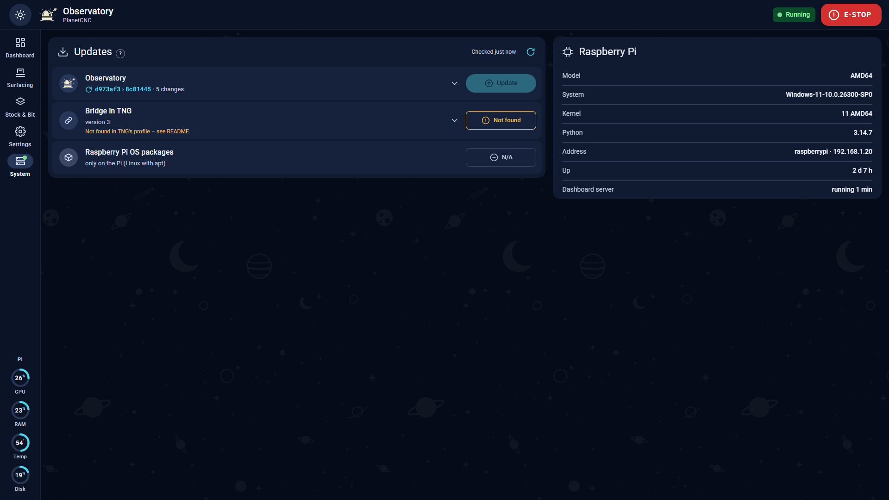
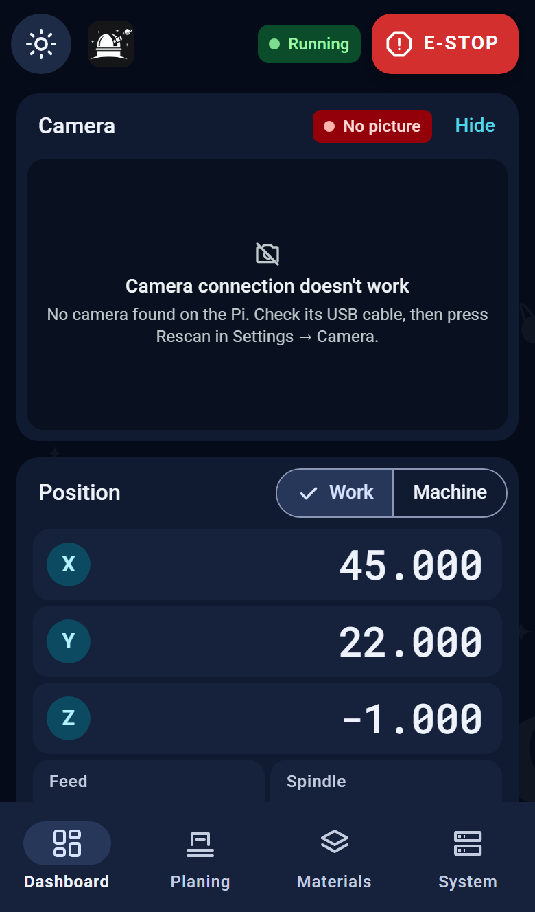
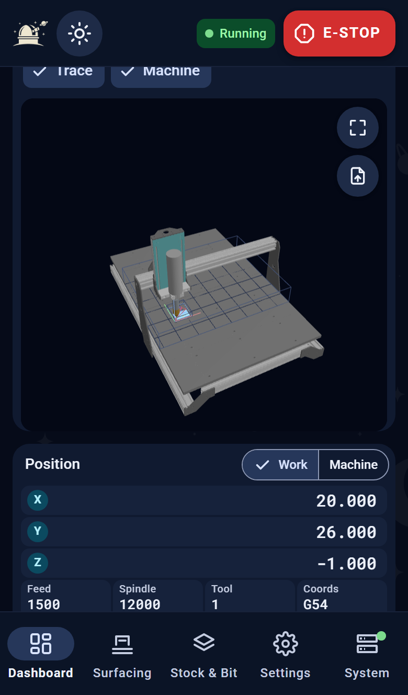
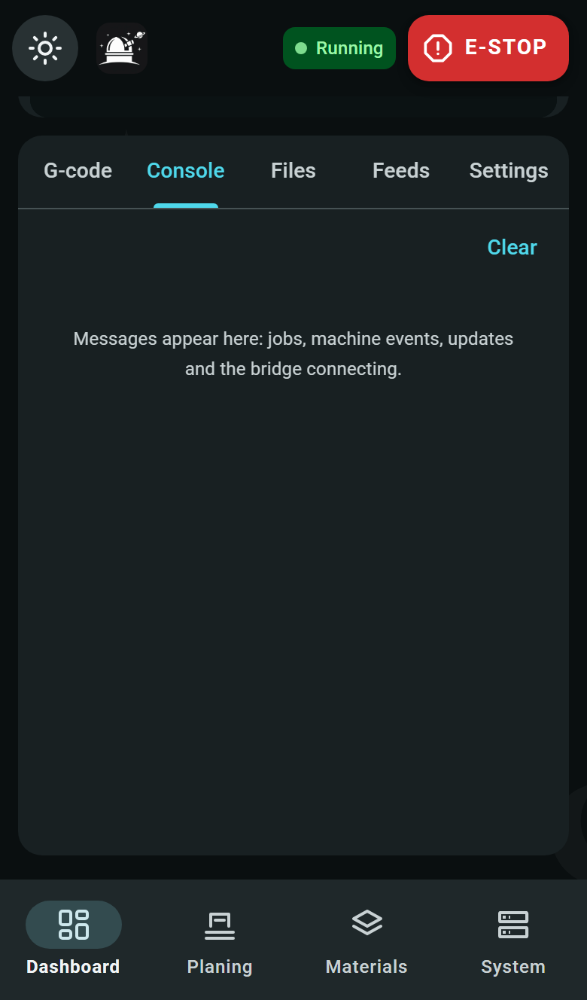
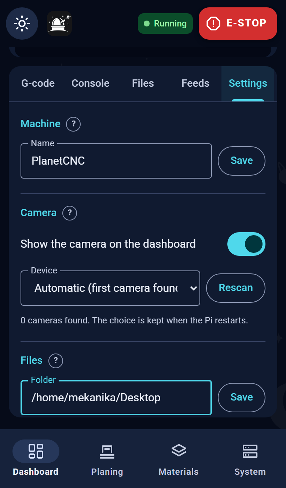

<p align="center"></p>

# PlanetCNC Observatory

**Observatory** is a web dashboard for a CNC machine run by PlanetCNC TNG. Open
it from any computer, tablet or phone on the home network to watch the machine
and the job it is running, in day or night mode.


*The dashboard on the real machine during a job: live camera and position on
the left, the 3D toolpath with the tool's trace in the middle, the G-code on
the right.*

## Contents

- [Features](#features)
- [Screenshots](#screenshots)
- [How it works](#how-it-works)
- [What you need](#what-you-need)
- [Installation](#installation)
- [Using the dashboard](#using-the-dashboard)
- [Telegram notifications and timelapse](#telegram-notifications-and-timelapse)
- [Home Assistant](#home-assistant)
- [Updating](#updating)
- [Logs and debugging](#logs-and-debugging)
- [Server options](#server-options)
- [Inside the bridge](#inside-the-bridge)
- [Troubleshooting](#troubleshooting)
- [Uninstalling](#uninstalling)

## Features

**Watch the machine**

- Live position of every axis (X, Y, Z, plus A, B, C when used), in work or
  machine coordinates, updated 5 times a second.
- Feed rate, spindle speed, tool number and coordinate system.
- Status at a glance: running, paused, E-stop, idle or offline; the Pi's
  CPU, memory, temperature and disk as rings in the menu, on every page.
- The workshop's **air quality** from a SEN55 sensor in Home Assistant (dust,
  VOC, NOx, temperature, humidity), as rings in the menu above the Pi's.
- **Shop devices**: switches, lights and fans from Home Assistant (a smart
  plug for the dust extraction, the shop lights, an air filter) as switches in
  the top bar, on every page.
- A software **E-stop** button, always in view. It is the only thing the
  dashboard can make the machine do; it only switches E-stop on, and releasing
  it happens at the machine.
- Job progress: current line, percentage, start time, elapsed time and time
  remaining.
- Live picture from a USB camera pointed at the machine (MJPEG through ffmpeg),
  fullscreen with a double-click. The camera also has a page of its own, for a
  second screen or a phone, and a stream and a still-picture address for other
  programs.

**3D view**

- The machine's real travel area as a grid and box, from TNG's motor limits,
  with the work zero marked.
- The machine itself (an EVO-M): the frame and its six spoilboards, and the
  gantry, the X carriage and the spindle moving with the live position (and
  with the simulated bit on the Surfacing page).
- The job's toolpath, shaded by depth, with rapids in red. Large 3D jobs are
  simplified so they stay smooth, within a stated tolerance.
- The tool at its real diameter and shape (flat, ball, bull nose, V-bit,
  drill), read from Fusion 360 tool comments in the G-code.
- The trace of where the tool has actually been during this job.
- 3D, top, front and right views; fit, follow-the-tool, mouse and touch control.
- Preview any G-code file from your computer against the bed before cutting,
  without touching TNG.

**On your phone, through Telegram**

- Messages from your own Telegram bot when a job starts, every few percent
  or minutes (you choose), when it pauses, on E-stop and when it ends (finished, or stopped at
  which line), each with a camera photo. Also when TNG drops out during a job,
  Pi warnings (under-voltage, heat), and when the air quality gets high.
- A **timelapse** of every job from the camera: a short video, sent with the
  "job ended" message.
- `/status` and `/photo` in the chat, and `/devices` to switch the
  [shop devices](#shop-devices). The bot can't control the machine.

**In Home Assistant, over MQTT**

- The machine as a Home Assistant device, set up automatically: status, job
  progress, the operation being cut and its progress, time left, tool,
  spindle and feed.
- The Pi's health (CPU, memory, temperature, disk, power) and network (IP and
  MAC address, WiFi network, signal and quality). It only reports.

**Program, console and files**

- The G-code program, with the line being run highlighted and kept in view.
- A console of what happened: jobs started, paused and ended (with how long
  they took), E-stop, tool changes, program changes, updates, the bridge
  connecting or getting lost.
- A Files tab for a folder on the Pi: browse, preview G-code in the 3D view,
  download, upload (also by drag and drop), make folders, move and delete.

**Feeds and step height**

- A **Feeds & steps** window to change, per operation, the feeds, spindle
  speed, drilling peck depth and step height of a program on the Pi, or leave
  operations out, without going back to the PC. The result is saved as a new file; the original stays.
- A **Feeds** tab that keeps every adjustment, how each job with it went, and
  the values you marked as working, ready to copy into Fusion 360.

**Surfacing rough stock**

- A **Surfacing** page that makes the program to flatten the top of rough
  stock: enter the stock size, the bit, the depth to remove, step-down,
  stepover, cut direction (along the grain), spindle speed and feeds. With
  Z zero on the spoilboard, it instead cuts stock that's already flat to a
  target thickness.
- The stock and the bit drawn at their real size in the machine's travel,
  with a warning when the path doesn't fit.
- A simulation of the cut: play, pause, speed and scrub through it, with the
  stock's top going from rough to surfaced and the estimated run time.
- Cutting values saved per stock (oak, cherry, …), shared by every device,
  on a Stock & Bit page where you can change, add, delete, import and export them.
- The program is saved in the Files folder, and can be loaded in TNG from
  the page; you start it at the machine.

**Look**

- Material 3 design, in night mode (a deep-space navy) and day mode (a warm
  moonlight white): the button next to the logo switches, and each browser remembers its choice (the computer's own setting
  at first). The 3D views follow.
- The same top bar and menu on every page; on a phone the menu moves to the
  bottom of the screen.
- Faint stars and planets behind the cards, drifting slowly as the page
  scrolls (a parallax; still when the computer is set to reduce motion).

**The Raspberry Pi and the app**

- Pi health: CPU, memory, temperature, disk use, uptime, and under-voltage or
  throttling warnings from the Pi's firmware.
- Settings in the page: machine name, camera, Files folder, tool display.
- A **System** page: one-click updates of the app from GitHub, with rollback
  (the bridge inside TNG reloads itself, so TNG keeps running); Raspberry Pi OS
  package upgrades; the Pi's model, OS, kernel and uptime, with reboot and shut
  down.
- A log with automatic cleanup, readable and downloadable from the dashboard.
- Works on phones and tablets; several people can watch at the same time.
- Nothing to install with pip: only Python's standard library on the Pi.

**Left out on purpose**

- **No machine control, apart from the E-stop and loading a program.** The
  dashboard can't move, home, start, pause or resume the machine, release the
  E-stop, or send G-code. For safety, everything that makes the machine do
  something happens at the machine, in TNG. It can load a G-code file from
  the Files folder into TNG (when nothing runs), which only opens the file:
  starting it is still done at the machine. This isn't just hidden in the
  page: the server has no way to send other commands, and the bridge inside
  TNG refuses anything but reading, switching the E-stop on and opening a
  G-code file while the machine isn't running.
- **No password.** Anyone on the home network who opens the page can see it,
  manage the files in the Files tab, press the E-stop and, once you allow it,
  upgrade or reboot the Pi when no job runs. Don't make the dashboard
  reachable from the internet.

## Screenshots

These were taken with the built-in demo (`python3 server.py --demo`), which
simulates a job. The demo has no camera and doesn't run on a Pi, so the camera
card says why it has no picture, and the Raspberry Pi's health rings show
made-up values.

### Desktop



The dashboard on a 1920×1080 screen, in night mode. Left: the camera, the
position, feed, spindle, tool, and the job's progress and times. Middle: the
3D view with the machine's travel, the toolpath (light blue cuts, red rapids),
the yellow trace of where the tool has been, and the tool. Right: the G-code,
with the line being run highlighted.



The same in day mode: the button next to the logo switches.



The **Console** tab lists what happened with times, here the demo job
starting and its earlier runs ending, with how long each took.



The **Settings** page: one card per subject (machine name, camera, Files
folder, how the tool is drawn and the logs; Telegram with its messages and
timelapse; Home Assistant with the air quality, the shop devices and MQTT), in
as many columns as the window has room for.



The **Surfacing** page: the rough stock and the 50 mm surfacing bit in the
machine's travel, with the toolpath, and the settings on the right.



The **System** page: updates of the app, the bridge in TNG and Raspberry Pi
OS, and the Pi itself (here the demo running on a PC, with an update waiting).

### Phone

<table>
<tr>
<td width="25%"></td>
<td width="25%"></td>
<td width="25%"></td>
<td width="25%"></td>
</tr>
<tr>
<td>Camera, position and job come first.</td>
<td>Scroll down for the 3D view (one finger rotates, two zoom and pan) and the G-code.</td>
<td>The Console tab.</td>
<td>The Settings page.</td>
</tr>
</table>

On a phone (here 390×844, an iPhone 14) the columns stack: camera, position
and job first, then the 3D view, then the tabbed panel. The menu is at the
bottom; the top bar keeps the logo (the day / night switch), the status and the
E-stop.

To retake these after changing the page, see `tools/screenshots.py` (runs on a
PC with Chrome or Edge; not needed on the Pi).

## How it works

```
 ┌──────────── Raspberry Pi ─────────────────────────────┐
 │                                                       │
 │  PlanetCNC TNG                                        │
 │   └─ bridge (planetcnc_bridge.py, runs inside TNG)    │
 │        │  machine state 5x/s, program, log lines      │
 │        ▼  ▲ what to read, and the E-stop (only on)    │
 │  server.py ◄── USB camera (through ffmpeg)            │
 │        │                                              │
 └────────┼──────────────────────────────────────────────┘
          ▼ http://<pi-address>:8080
   browsers on the home network (PC, tablet, phone)
```

There are three parts:

1. **The bridge** (`bridge/planetcnc_bridge.py`) runs inside TNG, because only
   there can Python read TNG's state through the `planetcnc` module. Five
   times a second it reads the values the server asks for and sends them to
   the server. When the loaded program changes, it sends the program to the
   server as well. It only reads, with two exceptions: when the dashboard's
   E-stop button is pressed, it switches TNG's E-stop on, and it opens a
   program in TNG when asked to (never while the machine runs).
2. **The server** (`server.py`) is a small web server written in Python, using
   only the standard library, so there's nothing to `pip install`. It turns the
   bridge's raw values into what the dashboard shows and pushes every change
   to each open dashboard. It also streams the camera, lists the Pi's files,
   runs updates (of itself and of the Pi's OS packages) and writes the log.
3. **The dashboard** (`web/`) is the page the browser loads. It draws the 3D
   view with three.js, which the browser downloads from a CDN, so the device
   viewing it needs internet access. The Pi itself doesn't.

The bridge and the server run on the same Pi and talk over `127.0.0.1`. By
default the server only accepts a bridge from the Pi itself.

### Files

| File | What it is |
|---|---|
| `server.py` | The web server. |
| `bridge/planetcnc_bridge.py` | Runs inside TNG: reads TNG's state and sends it to the server. |
| `bridge/bridge_autostart.py` | Started by TNG at startup; runs the bridge in the background and restarts it after a crash. |
| `bridge/Expr_WebMonitor.txt` | Tells TNG to run `bridge_autostart.py` when it starts. |
| `update.sh` | Gets the latest version from GitHub and copies the bridge files into TNG's profile. |
| `tools/setup-sudo.sh` | Optional: lets the System page upgrade OS packages and reboot the Pi (see [step 7](#7-optional-allow-os-upgrades-and-reboot-from-the-dashboard)). |
| `tools/screenshots.py` | Retakes the README screenshots from the demo (on a PC, not needed on the Pi). |
| `tools/machine_model.py` | Makes the light machine model `web/machine/evo-m.glb` from the complete CAD export (on a PC, not needed on the Pi; see [The machine in the 3D view](#the-machine-in-the-3d-view)). |
| `media/` | The animation and screenshots in this README. |
| `web/` | The pages (HTML, CSS, JavaScript). `style.css` holds the look of every page, day and night; `theme-boot.js` sets the day / night mode before a page is drawn; `fonts/` are Roboto and Roboto Mono, `sky.svg` the faint stars behind the cards (moved by `topbar-boot.js` as the page scrolls). `tune.js` reads and rewrites programs for the Feeds & steps window; `system-ui.js` holds the E-stop button and the System page (`system.html`, `system.js`); `topbar-boot.js` draws the top bar and the menu (and runs the day / night switch, the logo) before each page is shown, and `nav.js` keeps them current; `help.js` the **?** help popups in Settings; `settings.html` and `settings.js` the Settings page; `materials.html` and `materials.js` the Stock & Bit page (stocks and surfacing bits); `camera.html` is the camera page on its own; `mjpeg.js` reads the camera stream for both (so the frames can be counted); `surfacing.html`, `surfacing.js` and `surfacing-gcode.js` are the Surfacing page; `machine/evo-m.glb` is the machine drawn in the 3D view. |
| `settings.json` | Created when you change a setting in the dashboard; it also holds the Telegram bot token, the MQTT password and the Home Assistant token, so only its owner may read it. Not part of git. |
| `timelapses/` | The last 20 job timelapses. Not part of git. |
| `tuning.json` | The Feeds tab's log of adjusted files. Not part of git. |
| `surfacing_presets.json` | The Surfacing page's cutting values per stock (Stock & Bit page). Not part of git. |
| `logs/` | The server's log files. Not part of git. |

## What you need

- A Raspberry Pi (or another Linux computer) running **PlanetCNC TNG** with
  the machine connected. This guide uses the setup it was written for:
  - user `mekanika`;
  - app in `/home/mekanika/PlanetCNC_Observatory`;
  - TNG profile in `/home/mekanika/PlanetCNC/Profiles/Default`.

  Replace these with your own where they differ. Where this guide writes
  `<pi-address>`, use your Pi's address on your network, for example
  `192.168.1.20`. Step 3 shows how to find it.
- **Python 3.8 or newer.** Raspberry Pi OS already has it.
- **git**, to install and update the app.
- **ffmpeg**, only if you want the camera.
- A **USB camera** (optional). Most webcams work. A camera that sends MJPEG
  costs the Pi almost no CPU.

## Installation

Do all of this on the Pi, at its keyboard or over SSH
(`ssh mekanika@<pi-address>`).

### 1. Install git and ffmpeg

```bash
sudo apt update
sudo apt install git ffmpeg
```

### 2. Get the app

```bash
git clone https://github.com/Benoit-LdL/PlanetCNC_Observatory ~/PlanetCNC_Observatory
```

Keep it a git clone: the dashboard's update button and `update.sh` rely on it.
Don't edit files in this folder by hand, because changed files block updates.

### 3. Try the server

```bash
cd ~/PlanetCNC_Observatory
python3 server.py --demo
```

`--demo` simulates a machine running a job, so you can check the dashboard
before TNG is involved. The server prints the address to open:

```
  Open the dashboard (demo):
    from another device on your network:  http://192.168.1.20:8080
    on this computer:                     http://localhost:8080
  Press Ctrl+C to stop.
```

Open the first address in a browser on another device (your numbers will
differ). That address is your Pi's `<pi-address>`; keep it for later. You
should see the demo part being cut. Press Ctrl+C to stop the server.

The demo also runs on any PC with Python 3.8+, without TNG, if you just want
to look at the dashboard. `hostname -I` on the Pi also shows its address.

### 4. Enable Python in TNG

TNG has to know where Python's shared library is. Find it:

```bash
ls /usr/local/lib/libpython3* /usr/lib/*/libpython3*
```

If nothing is listed, run `sudo apt install libpython3-dev` and look again.

In TNG, open **Settings → Python Library** and enter the full path of the
`libpython3.x.so...` file, e.g. `/usr/local/lib/libpython3.11.so.1.0`. Press
**Check**: it should show the Python version. Then restart TNG.

### 5. Install the bridge into TNG

```bash
~/PlanetCNC_Observatory/update.sh
```

This copies three files into TNG's profile:

| Copied to | File |
|---|---|
| `Profiles/Default/Scripts/` | `planetcnc_bridge.py`, `bridge_autostart.py` |
| `Profiles/Default/Expr/` | `Expr_WebMonitor.txt` |

TNG runs the `#OnInit` section of every `Expr*.txt` file in that folder when
it starts. `Expr_WebMonitor.txt` uses it to start the bridge through
`bridge_autostart.py`, in the background so TNG doesn't wait for it. It's a
separate file, so the machine maker's own `Expr.txt` stays untouched.

For another profile, put `PCNC_PROFILE=/path/to/profile` in front of the
command. `Expr_WebMonitor.txt` and `bridge_autostart.py` contain the full
profile path, so adjust it in both files too.

### 6. Start the server at boot

Create the service file:

```bash
sudo nano /etc/systemd/system/planetcnc-web.service
```

with this content (change the user and paths if yours differ):

```ini
[Unit]
Description=PlanetCNC Observatory
After=network-online.target
Wants=network-online.target

[Service]
User=mekanika
EnvironmentFile=-/etc/planetcnc-web.env
WorkingDirectory=/home/mekanika/PlanetCNC_Observatory
ExecStart=/usr/bin/python3 /home/mekanika/PlanetCNC_Observatory/server.py
Restart=always
RestartSec=3

[Install]
WantedBy=multi-user.target
```

`Restart=always` matters: after an update the server stops itself, and
systemd starts the new version.

Then enable it:

```bash
sudo usermod -aG video mekanika           # let that user read the camera
sudo systemctl daemon-reload
sudo systemctl enable --now planetcnc-web
```

To pass [server options](#server-options), add them to the `ExecStart` line,
then run `sudo systemctl daemon-reload && sudo systemctl restart planetcnc-web`.

### 7. Optional: allow OS upgrades and reboot from the dashboard

The System page shows which Raspberry Pi OS packages can be upgraded. To
also upgrade them, refresh the package lists, and reboot or shut down the Pi
from there, the server needs to run those few commands as root. Allow exactly
those, and nothing else:

```bash
~/PlanetCNC_Observatory/tools/setup-sudo.sh
```

It writes `/etc/sudoers.d/planetcnc-web` for the user that runs it (give
another user's name as argument if the server runs as someone else), after
checking the file with `visudo`. It allows `apt-get update`,
`apt-get upgrade` (with fixed options) and `systemctl reboot` / `poweroff`,
without a password. `tools/setup-sudo.sh remove` takes it away again.

If your user already has sudo without a password (some Raspberry Pi OS
installs do), this works without the script.

### 8. Restart TNG and check

Restart TNG (or the whole Pi). Then check each part:

| Check | Expected |
|---|---|
| TNG's output window | `PlanetCNC web bridge: connected to http://127.0.0.1:8080` |
| `systemctl status planetcnc-web` | `active (running)` |
| `journalctl -u planetcnc-web -n 20` | `Observatory on http://<pi-address>:8080` and `bridge: connected from 127.0.0.1` |
| http://&lt;pi-address&gt;:8080 | Status shows **Idle** (not **Offline**), the position matches TNG |

If something doesn't match, see [Troubleshooting](#troubleshooting).

Then press the dashboard's **E-stop** once, while the machine is idle: TNG
should go into E-stop. Release it at the machine.

### Starting by hand instead

For testing without the service and the autostart:

```bash
cd ~/PlanetCNC_Observatory && python3 server.py
```

and in TNG, **File → Run Python Script** →
`Profiles/Default/Scripts/planetcnc_bridge.py`. The server only runs as long
as its terminal stays open.

## Using the dashboard

Open **http://&lt;pi-address&gt;:8080** (see [step 3](#3-try-the-server)). The page adapts to tablets and phones.

### Top bar

The top bar is the same on every page, and stays still when you move between
pages (Edge, Chrome and Safari cross-fade the page below it; in other browsers
the page simply loads).

- The logo, in the top left corner, is the **day / night** switch: it is
  moon-coloured at night and space-coloured by day. Hover over it and it starts
  to turn, the other colour peeking in from the side; a click turns it the rest
  of the way and the new mode spreads over the page from the logo. Each browser
  remembers its choice; at first it follows the computer's own setting.
- **Observatory** and the machine's name (set in Settings), next to it; a click
  goes to the dashboard. On a phone only the logo shows.
- **Shop devices** (when [set up](#shop-devices)): a chip per device after the
  machine's name, filled while it is on, dashed when Home Assistant can't reach
  it. Click one to switch it: it pulses until Home Assistant shows the new state
  (a second or two); hover over it for its state (a fan with its speed,
  **On · 66 %**). Those that don't fit fold into **+N**, which opens the list.
  On a phone: the **plug** button next to the air button (blue while one is on)
  opens the list, one row per device with a switch.
- On a phone, with the [air quality](#air-quality) set up: the **air** button,
  in the colour of the worst reading (see below).
- The status:

  | Status | Meaning |
  |---|---|
  | **Running** (green) | A job is running. |
  | **Paused** (yellow) | The job is paused. |
  | **E-stop** (red, blinking dot) | The emergency stop is active. |
  | **Idle** | Connected, no job running. |
  | **Offline** (outlined) | The server gets no updates from the bridge, or this page lost its connection to the server. |

- The red **E-STOP** button, see [E-stop](#e-stop).

The menu sits on the left (at the bottom on a phone): **Dashboard**,
**Surfacing** (the [Surfacing page](#surfacing-rough-stock)), **Stock & Bit** (the
[Stock & Bit page](#stock--bit)), **Settings** and **System** (the [System page](#system-page)).
The page you are on is highlighted. A green dot on **System** means an update
of the app or of the OS is available.

### E-stop

The red **E-STOP** button at the right of the top bar, on every page (and at
the top of the Feeds & steps window), switches TNG's E-stop on, like the E-stop
command in TNG. TNG stops the machine at once.

- One tap, no confirmation: it is meant for an emergency.
- It only switches E-stop **on**. Pressing it again does nothing. To go on,
  release the E-stop at the machine, in TNG, and start again there.
- It reaches TNG through the bridge, so it takes up to a few tenths of a
  second, and it needs the network, the Pi and TNG to work. **It doesn't
  replace the machine's own emergency stop button**, which cuts the power
  directly.
- It's greyed out while TNG isn't connected ("use the E-stop at the
  machine"), while E-stop is already on (**ENGAGED**), and while the bridge in
  TNG is too old for it (install the update; see the System page).
- If it fails, the page says so in a pop-up: use the machine's E-stop.
- The Console and the log say who pressed it (the device's address and
  browser).

### Left column

- **Camera** at the top:
  - **Live** (green) means the camera sends a picture; **No picture** (red)
    that it doesn't.
  - When there is no picture, the panel says **Camera connection doesn't
    work** and why: no camera found on the Pi, the camera set to **Off**,
    ffmpeg not installed, or no picture coming from the camera.
  - The **fps** counter in the picture's top-right corner counts the frames
    that really reach this browser each second, so a frozen or stuttering
    picture shows. It turns red below 1 fps (0.5 fps means the camera stopped
    sending: the Pi only repeats the last frame every 2 s), and says **No
    frame for N s** when the connection stalls; after 10 s it reconnects.
  - **Full**, or a double-click, shows it fullscreen; **Exit full screen**, a
    double-click or Esc go back. **Hide** folds it away;
    each browser remembers this. To remove the panel for everyone, turn off
    **Show the camera on the dashboard** in Settings.
  - The Pi only runs the camera while someone has the dashboard open. A
    browser tab in the background doesn't keep it running.
  - The camera can also be opened on its own, without the dashboard: see
    [The camera on its own](#the-camera-on-its-own).
- **Position** of each axis. Switch between **Work** and **Machine**
  coordinates with the tabs. A, B and C only appear when they are used.
- **Feed, spindle, tool, coordinate system.**
- **Job:** the loaded file, the progress (percentage and bar), the **line**, **start time, elapsed time** (since the job started, pauses
  included), **time remaining** (TNG's own estimate when it has one) and the
  time of the last update. The console also says how long a job took when it ends.
- On a phone, the **Air quality** card (when set up) and the **Raspberry Pi**
  card: the same rings as in the menu (see below), with the temperature and
  humidity, the Pi's uptime and its power status.

### Raspberry Pi health

At the bottom of the menu, on every page, four rings show the Pi's **CPU**,
**memory** (RAM), **temperature** and **disk** use, refreshed every 2 seconds.
On a phone they are in the dashboard's Raspberry Pi card instead.

- A ring and its value turn amber or red when a value gets high; hover over a
  ring for the details and the word (busy, high, warm, hot, full). The
  temperature ring spans 20 to 90 °C: the Pi slows itself down from about
  80 °C.
- A lightning mark under the rings is the power status from the Pi's
  firmware: amber when the Pi was short of power or throttled earlier, red and
  blinking for **Under-voltage!** right now. A weak supply is a common cause of
  random Pi problems.
- A click on the rings opens the [System page](#system-page).

### Air quality

With a SEN55 air-quality sensor in Home Assistant (set up in
[Settings](#settings-page)), the menu shows the air above the Pi's rings, on
every page, refreshed every 10 seconds. On a phone the menu is a bar at the
bottom without room for it: the **air** button in the top bar takes its place
(green, amber or red after the worst reading, grey while waiting); a tap opens
a panel with the status, temperature and humidity, the rings and, under them,
the alert (below). A tap elsewhere closes it.

- Up to six rings: **PM1**, **PM2.5**, **PM4** and **PM10** dust (µg/m³), and
  the **VOC** and **NOx** indexes (PM1 and PM4 only when set up in Settings).
  Under the rings: temperature and humidity.
- Hover over a ring (tap it on a phone) for what its value means:
  - **VOC** and **NOx**: what the index compares against (VOC 100 = the
    room's average of the last 24 hours, NOx 1 = clean air), typical sources,
    and a table of ranges with the current one highlighted. These ranges are a
    rule of thumb, not health limits: the indexes learn the room (give them
    about a day after a first start) and show events, such as when to open a
    window.
  - **PM2.5** and **PM10**: the same kind of table, with the current range
    highlighted (PM2.5: 0–5 clean, 5–15 fine, 15–50 raised, 50+ high; PM10:
    0–15, 15–45, 45–100, 100+), built on the WHO 2021 guidelines (PM2.5
    15 µg/m³ over 24 hours and 5 over a year; PM10 45 and 15). Those are
    averages, not limits for one reading.
  - **PM1** and **PM4**: what they measure. The WHO gives no guideline for
    them, so they have no table and their rings don't change colour: they are
    part of PM2.5 and PM10, which do.
- A ring turns amber (raised) or red (high) from PM2.5 15 / 50 and PM10 45 / 100
  (amber from the WHO 2021 24-hour guideline, red far above it), VOC 150 / 250
  (100 is the room's usual air) and NOx 20 / 150 (1 is clean air).
- While a value is raised or high, an alert says which, framed in red and white
  hazard tape: on a computer a small box next to the air rings, on the dashboard
  and the Surfacing page; on a phone tape around the air button, on every page,
  and the alert in its panel. The tape blinks when one is high
  (not with "reduced motion" set on the computer). It stays until the values are
  back in the green. Telegram can warn too (see [Telegram](#telegram-notifications-and-timelapse)).
- The dot next to **Air**: green Good, amber Raised, red High (or **No
  data** when Home Assistant doesn't answer, with the reason when you hover).
  Grey while waiting for the first reading; amber when the last reading is
  more than a minute old.
- In a short window (a laptop) the air and Pi rings are smaller, two per row,
  so everything still fits in the menu.

### 3D view (middle)

- **The grid and box** are the machine's real travel, from TNG's motor limits
  (Settings → Motors → Limits), placed relative to your current work zero.
  The red, green and blue arrows mark work zero.
- **The toolpath.** Cutting moves are shaded by depth: light at the top, dark
  blue at the deepest cut. Rapids are dark red. The thin box around the job
  covers every move.
  - Big 3D jobs have millions of tiny moves, too many to draw smoothly. The
    view drops points that lie within a small distance of a straight line
    through their neighbours. The shape stays, but there are far fewer lines.
  - The note under the view says how many moves are drawn and how far the
    drawing can be from the real path, for example "10k of 480k moves drawn
    (within 0.012 mm)".
- **The tool** is drawn at its real diameter and shape (flat, ball, bull nose,
  V-bit or drill) when the size is known and this is turned on in Settings:
  a gold cutter on a steel shank, under the spindle (or in a see-through
  holder when the machine is hidden). Under the tool
  number, the left panel says which size is drawn and where it came from,
  e.g. "Ø6 mm (program)". The size comes from:
  1. the tool comments the CAM program writes at the top of the file, such as
     Fusion's `(T5 D=3. CR=0. - ZMIN=-10.2 - FLAT END MILL)`, for the tool the
     program selects at the current line;
  2. otherwise the diameter TNG reports for the loaded tool, if it has one
     (converted when TNG and the program use different units);
  3. otherwise a generic bit sized to the grid.
- **Machine** shows the machine around the travel: the frame and the
  spoilboards stay still, the
  gantry moves with Y, the X carriage with X and the spindle with Z, so the
  spindle's nose always sits on the tool. It needs TNG's limits (the travel)
  to know where to go, so it is hidden without them. Turn it off to see only
  the job; the choice is remembered in this browser.
- **Trace** (yellow) shows where the tool actually went during this job.
- **3D / Top / Front / Right** switch the angle; **Follow** keeps the tool
  centred.
- The buttons at the top right of the view: **Fit** (the square) shows the
  bed, the job and the machine; the file button (**Open file**) previews a G-code file from your computer, without touching
  TNG, so you can check its origin and orientation against the bed. Only this
  screen shows it. **Close preview** goes back to TNG's program.
- **Mouse:** left-drag rotates (3D only), right-drag pans, the wheel zooms.
  **Touch:** one finger rotates, two fingers zoom and pan.

#### The machine in the 3D view

The machine is drawn from `web/machine/evo-m.glb`, a light version (0.4 MB,
20k triangles) of the complete CAD model of the EVO-M: only the aluminium
extrusions, the metal plates, the spindle (as a plain cylinder) and the six
spoilboards. It is placed by assuming that:

- the machine has the 350 mm Z upgrade: the CAD is the 250 mm version, so the
  script makes the gantry 100 mm taller and the Z slide 100 mm longer
  (`--z-extra 0` for a 250 mm Z);
- the travel (TNG's limits) is centred on the frame, in X and in Y;
- the lowest Z the tool can reach is just above the spoilboards;
- the machine's X, Y and Z run the same way as the CAD model's.

If the drawing is off on your machine, that's the place to look. To make the
model again after changing the CAD (on a PC, with Python 3; the complete export
is too big for git, so `CAD/` is not part of it):

```
python tools/machine_model.py "CAD/EVO-M V1.0.glb" --spoilboard CAD/spoilboard.obj
```

It keeps the extrusions, plates and spindle (recognised by their shape) and
leaves out the motors, wheels, bearings, leadscrew and screws, simplifies what
is left, and sorts it into the frame, the gantry, the X carriage and the Z axis
by where it is in the CAD. The spoilboard (one board, exported in the same
coordinates) is laid six times side by side; `--boards` changes the count. The boxes it uses for that are at the top of the script;
`--report` lists the parts per group without writing anything.

### G-code, Console, Files and Feeds (right)

One panel with a tab for each; it uses the full height of the window.

**G-code.** The line being run is highlighted and kept in view. Scroll to look
around; **Follow line** jumps back to the current line.

**Console.** What happened, with times:

- job started, ended (with how long it took) or paused, E-stop, tool changes,
  program loaded;
- software updates;
- the bridge connecting or getting lost.

A dot on the tab means new lines arrived (red if one is an error). **Clear**
empties this view only. The server keeps the last 500 lines.

**Files.** A folder on the Pi: the Desktop by default, or the one chosen in
Settings. The tab only appears when there is a folder.

- Click a folder to open it, and the path at the top to go back. The list
  refreshes by itself every 15 seconds.
- Per folder: the pencil renames it (not the folder holding the file loaded
  in TNG), and the arrow downloads it, with everything in it, as a zip.
  **Download all** does the same for the folder shown.
- Per file: the eye previews G-code in the 3D view, the tray arrow loads it
  in TNG (only when the machine isn't running; it is not started), the
  sliders open the [Feeds & steps](#feeds--steps) window, the arrow downloads
  the file, and the bin deletes it (after asking).
- **New folder** makes a folder in the folder shown.
- **Drag files onto the panel** (on any tab), or press **Upload**, to put them
  in the folder shown. An existing file is only replaced after you confirm.
- **Move a file** by dragging its row onto a folder in the list, or onto a
  folder in the path at the top (to move it up). An existing file of the same
  name is only replaced after you confirm. The file loaded in TNG can't be
  moved. Drag and drop needs a mouse: it may not work on phones and tablets.

**Feeds.** Every file saved from the Feeds & steps window (see below), newest
first: what changed in each operation compared to Fusion, and each job run
with it ("ran to the end" or "stopped at line …", with how long it took).

- Mark each one **Worked**, **Still too much** or **Not sure yet**, and add a
  note (sound, chips, finish).
- **Worked – copy these into Fusion** at the top lists, per tool and
  operation, the newest values you marked as working, next to the Fusion
  values they replace.
- When a job with an adjusted file ends, the console reminds you to mark it.
- The log is kept in `tuning.json` next to `server.py` (up to 500 entries).
  Removing an entry leaves the file on the Pi.

### Settings page

**http://&lt;pi-address&gt;:8080/settings**: open it with **Settings** (the
cog) in the menu. One card per subject, side by side when the window is wide
enough. Everything here is saved on the Pi and applies to everyone.

- **Name:** the machine's name, shown under **Observatory** in the top bar,
  in the browser tab and in Telegram messages, for everyone.
- **Camera:** **Automatic** (the first camera found), a specific camera, or
  **Off**. The change applies right away.
  - **Show the camera on the dashboard** shows or hides the camera panel, for
    everyone (on at first). Hiding it doesn't turn the camera off: Telegram
    photos, the timelapse and the camera page still use it.
  - USB cameras are listed by their stable name, so the choice still works
    when the camera is plugged into another port.
  - **Rescan** looks again after you plug a camera in.
- **Files:** the folder shown in the Files tab. **Browse…** opens a list of
  the Pi's folders (names only), with shortcuts to your home folder, USB
  drives and the whole disk: open folders to go down, and press **Use this
  folder**. Or type a path on the Pi and press **Save**. **Default** goes back to `--files-dir`. If the chosen folder is
  gone when the server starts, it uses `--files-dir`.
- **Tool in the 3D view:** **Show the real tool size and shape** turns the
  real-size tool on or off (off: always the standard marker). **CAM program**
  says whose tool comments to read; only **Fusion 360** for now. The choice
  applies to every open dashboard right away.
- **Telegram:** the bot and the chat, then its **Messages** (which ones, how
  often, which silently) and the **Timelapse**; see
  [Telegram notifications and timelapse](#telegram-notifications-and-timelapse).
- **Logs:** see [Logs and debugging](#logs-and-debugging).
- **Home Assistant**, one card in four parts:
  - **Address and token:** how the Pi reaches Home Assistant's REST API, for
    the next two parts.
  - **Air quality:** reads a SEN55 sensor for the menu; see
    [Air quality from Home Assistant](#air-quality-from-home-assistant).
  - **Shop devices:** the switches on the dashboard; see
    [Shop devices](#shop-devices).
  - **MQTT:** sends the machine to Home Assistant; see
    [Home Assistant](#home-assistant).

The explanations are behind the round **?** next to each title: hover over
it, or tap it on a phone or tablet. Settings are saved in `settings.json` next
to `server.py`. Updates keep them.

### System page

**http://&lt;pi-address&gt;:8080/system**: open it with **System** in the menu.

- **Updates**, one row per part, like an update manager: its name, the
  installed version (in blue, *installed › new*, when there is an update),
  and on the right **Up-to-date**, **Update** / **Upgrade**, or what is wrong
  (**Error**, **Blocked**, **Old**...). The arrow opens the details.
  - Checked each time the page opens: GitHub every time; the OS package lists
    when they are more than 15 minutes old and no program runs (refreshing
    them takes a while and works the Pi hard). The round arrow at the top
    checks both now. The Pi also checks both by itself every 6 hours.
  - **Observatory:** **Update** installs what is on GitHub. The
    details list the new changes and have **Roll back**, see
    [Updating](#updating).
  - **Bridge in TNG:** the version running inside TNG, and whether the copy in
    TNG's profile is the same as this version of the app. It is updated with
    the app.
  - **Raspberry Pi OS packages:** how many packages can be upgraded; the
    details list them, with old and new version, and say how old the package
    lists are. **Upgrade** runs `apt-get upgrade`; its output appears below,
    live. It can take several minutes. Afterwards, restart TNG or reboot the
    Pi so everything uses the new libraries; the row says when the Pi needs a
    reboot. Packages that need `apt full-upgrade` are listed as held back: do
    those over SSH.
- **Raspberry Pi:** model, OS, kernel, Python, name and address, how long the
  Pi and the dashboard server have been running, and, in the same card since
  they belong to the same hardware, **Reboot** and **Shut down**, after a
  confirmation. TNG closes with the Pi. After a reboot the page reloads itself
  when the Pi is back; after a shutdown, switch the Pi off and on to start it
  again.

Upgrading packages, rebooting and shutting down are refused while a program
runs, and need [step 7](#7-optional-allow-os-upgrades-and-reboot-from-the-dashboard)
of the installation. Without it the page still shows what can be upgraded,
from the package lists as the Pi last refreshed them.

### Feeds & steps

> **Experimental.** This rewrites G-code and has only been tested on a few
> programs; the window says so too. Before cutting with a new file, check it
> with **Preview**, keep a hand near the E-stop, and run the first moves (or
> the whole job) in the air above the part.

For when a cut turns out too heavy: stop it at the machine, change the values
here (from the Files tab, or **Feeds & steps** above the G-code of the loaded
program), save, and load the new file in TNG at the machine.

The window reads the program into its operations (Fusion writes each
operation's name, e.g. `(2D Adaptive1)`, before it) and shows for each one,
with the tool from Fusion's tool comments:

- **Feeds**, each named by what it's used for: cutting, lead-in/out, ramp,
  plunge, drilling, or retract (Fusion for personal use writes rapids as feed
  moves). **All feeds −20 % … +20 %** changes them together.
- **Include**: untick it to leave the operation out of the new file; it's
  greyed out. Its moves go, but what later operations rely on stays: spindle,
  coolant, work offset, tool length, modes, returns home, and its tool change
  when the next operation uses that tool without changing tools itself.
  Before the next operation's first move the tool goes up to that operation's
  top height (and, if that move is a cut, over to its start and down at the
  plunge feed).
- **Spindle speed** and, for peck drilling (G83, G73), the **peck depth**.
- **Step height**, for operations that cut in flat passes from top to bottom
  (2D pocket, 2D adaptive, contour with multiple depths). It lists the passes
  and the biggest step. A smaller **Max. stepdown** (Fusion's *Maximum
  roughing stepdown* under Multiple depths) adds extra passes: each
  original pass is preceded by copies of itself, lifted so every step is at
  most the new value. The original passes, the final depth and the shape stay
  exactly the same; every added pass removes less than the original one did.
  Between passes the tool goes up to the operation's highest point and back.
  The first step is measured from **Top of material Z** (guessed from the
  passes; check it). Steps can only be made smaller here. 3D operations (whose
  height changes all the time), drilling, and operations with tool or spindle
  changes between passes can't be split; the window says why.
- When the program is the one loaded in TNG and the job was stopped, it says
  in which operation, and after saving, at which line that operation starts
  in the new file, for TNG's start-from-line.

**Save** writes `name_adj1.nc` (or the next free number, or a name you type)
next to the original, never over the original itself; if a name you type is
already taken, it asks before replacing that file. The new file starts with a
comment block listing every value as "in Fusion -> in this file", so it also
says what changed when opened elsewhere. Adjusting an adjusted file again
keeps comparing to the values from Fusion. **Preview** shows the new program
in the 3D view first.

The window changes files only; like everything in the dashboard, it never
loads or starts anything in TNG. Its E-stop button works as in the top bar.

### Surfacing rough stock

**http://&lt;pi-address&gt;:8080/surfacing** (or **Surfacing** in the menu)
makes the program that surfaces the top of rough stock flat, with a surfacing
bit. Millimetres only. Laid out like the dashboard: the 3D view, and the
settings in the panel on the right.

**Inputs**

| Field | What it is |
|---|---|
| Length (X), Width (Y) | The stock's size. **X0 Y0 is its front-left corner.** |
| Z zero | Picks the job, and the fields below change with it. **Top of the stock** surfaces the rough face: touch off Z on the highest point; the program cuts from Z0 down. **Spoilboard** brings stock that's already flat to a thickness: Z0 is the spoilboard and the stock top is at Z = its current thickness. |
| Thickness (rough) | Top of the stock only. Just for drawing the stock and checking the depth fits in it, so a rough guess will do (15 mm by default). |
| Depth to remove | Top of the stock only. In total, from Z0 down; less than the thickness. |
| Current thickness | Spoilboard only. Measured at the highest point: the first pass starts there. No default. |
| Target thickness | Spoilboard only. The thickness you want: the last pass is at Z = target, and the program removes current − target. No default. |
| Start above Z0 | For when you're not sure Z was touched off on the highest point: the passes start this much above Z0 and still end at the same depth, so there are more passes and the first ones only skim the high spots (or cut air) instead of one pass biting too deep there. 0 (the default) starts at the top. |
| Bit | A saved bit fills in its diameter (**Save as…** saves the one in the form, **Delete** removes it; all of them are on the [Stock & Bit page](#stock--bit)). **Changed** shows when the diameter no longer matches the saved bit. |
| Bit diameter | The surfacing bit, drawn at this size. |
| Cut direction | Along X or along Y: usually along the grain. |
| Cut | **Both ways** (zigzag, the default and fastest), or **+X only** / **−X only** (+Y / −Y when cutting along Y): every line is cut in the same direction, and between lines the bit lifts to the safe height, goes back beside the stock in a rapid and comes down there. Slower, but it shows whether a tramming problem or tool marks depend on the direction of travel. |
| Stock (under **Cutting values**) | A saved stock (Oak, Cherry, …) fills in the cutting values below (see below). |
| Spindle speed, Feed, Plunge feed | Plunge feed is for going down to each pass, which always happens beside the stock. |
| Step-down | Depth per pass at most. The depth is split into equal passes. |
| Stepover | Sideways step between lines, as % of the bit diameter (40 % is a good start). |
| More settings | Safe height above the stock (5 mm), how far the bit's centre runs past the edges (5 mm, less than the bit radius), **Turn round clear of the stock** (off), spindle spin-up time (3 s). |

**The program** goes back and forth over the stock in lines along the chosen
direction, one Z level after the other. The bit's centre runs past every edge
of the stock by the *run past the edges* amount (less than the bit radius),
both at the ends of the lines and on the first and last line, so the edges are
surfaced as well. From the end of a line the bit turns round to the next one in
a half circle (`G2`/`G3`), bulging out past the line ends by half the gap
between lines: no sharp corners, so the machine doesn't stop and jerk at each
end and higher feeds stay smooth. The turn happens with the bit partly on the
stock; with **Turn round clear of the stock** on, the lines run on until
the whole bit has left the stock by that amount, so the turn happens in the
air instead (longer lines, a bit slower). Each level starts with the bit fully
beside the stock, so the plunges happen in the air, never in the wood. Each
pass runs the lines back from
where the last one ended. With **Cut** set to one direction only, the bit
instead lifts at the end of every line and comes back in a rapid, so each
line is cut the same way. It starts with `M3` and a `G4` pause for the spindle
to spin up, before any move (so don't leave the bit touching the stock), and ends with `M5` and the bit parked at the safe height right of the stock (at
Y0, the bit's edge 10 mm past the stock's right end), out of the way of taking
the stock off: it's assumed to sit in the front-left corner of the bed. When
the machine's travel is known (TNG connected), the end position is kept 1 mm
inside it, measured from the current work zero, so set X0 Y0 on the stock
before saving. If there isn't room to clear the stock, the program parks as far
right as it can and the page says so.
There is no tool change: the bit must already be in the spindle and Z touched
off. The file starts with comments listing the values, and a Fusion-style tool
comment so the dashboard draws the bit when the program is loaded.

**The 3D view** shows the machine's travel (from TNG, when the bridge is
connected), the stock (drawn with a flat top), the toolpath and the
bit, and with **Machine** the machine itself, its spindle following the
simulated bit (as on the dashboard; the choice is shared). The page warns when the bit's path leaves the machine's travel: that is
checked from the *current* work zero, so set X0 Y0 (and Z) on the stock first
for the check to mean something. Below the view, **Play** runs the simulation
(1× to 200×; drag the slider to jump): the top turns from rough (dark) to
surfaced (light) where the bit passes, in two close tones that take turns from
one pass to the next, so each pass shows apart. The run time is estimated from the feeds,
with rapids at 5000 mm/min.

**Stocks.** In **Cutting values**, **Save as…** stores the spindle speed, feeds,
step-down and stepover under the name of a stock (Oak, Cherry, …); picking it
later fills them in. The stock size, bit and depth (or thicknesses) are
entered each time. **Changed** next to the title means the form no longer
matches the saved stock. Stocks are kept on the Pi in `surfacing_presets.json`,
so every device sees the same ones. To see them all, change, rename, import or
export them, use the [Stock & Bit page](#stock--bit) (the link under the
cutting values, or **Stock & Bit** in the menu).

**Save** writes the program to the top of the Files folder (set in Settings),
named after the stock, size and depth, e.g. `surface_oak_600x200_3mm.nc`
(`…_to22mm.nc` with Z zero on the spoilboard); you
can type another name. If the file exists, it asks before replacing it.
**Load into machine** (next to **Save**) opens it in TNG, ready to run, without saving it in the Files
folder: it goes to a working file in `sent/` next to the server (only the
latest one is kept), named as in the name field. It is greyed out while the
machine runs or TNG isn't connected. Starting
the program always happens at the machine. The last values entered are remembered in the browser.

### Stock & Bit

**http://&lt;pi-address&gt;:8080/materials** (or **Stock & Bit** in the
menu) shows what the Surfacing page can fill in for you, in two tables:

- **Stock:** name (the wood: oak, cherry…), spindle speed, feed, plunge feed, step-down and stepover
  (% of the bit diameter).
- **Surfacing bits:** name and diameter.

On a phone each one is a card instead of a table row (name, then the values
with their titles, then Save and Delete), so nothing needs scrolling sideways;
Import and Export are just their icons there.

In both:

- **Change** a value or the name in a row: the row turns yellow and its
  **Save** button lights up. Saving under another name renames it.
- **Delete** removes one (after asking).
- **Add** one in the last row: a name and all the values, above 0.
- **Export** downloads all of them as `surfacing-stock.json` or
  `surfacing-bits.json`: a backup (they only live on the Pi, in
  `surfacing_presets.json` and `surfacing_bits.json`), or to move them to another Pi.
- **Import** adds them from such a file. If some names already exist, it asks
  once whether to replace them or keep yours.

A name already used (in any case: Oak = oak) is only replaced after you
confirm. The Surfacing page picks up the changes when you go back to it.

### The camera on its own

The camera doesn't need the dashboard. Three addresses show it directly, from
any browser on the network:

| Address | What it is |
|---|---|
| `http://<pi-address>:8080/camera` | A page with only the camera, filling the window. Double-click (or double-tap) for fullscreen. An fps counter in the bottom-right corner works as on the dashboard. Made for a second screen, a tablet next to the machine, or a phone. The machine's name is in the tab's title; a link in the top corner opens the dashboard. |
| `http://<pi-address>:8080/api/camera.mjpg` | The raw MJPEG stream. Browsers show it as a moving picture; it is also what to give a program that takes an MJPEG address (home automation, OBS as a browser source, a media player). |
| `http://<pi-address>:8080/api/camera.jpg` | One still picture, taken now. For a bookmark, a widget that refreshes an image, or a script that fetches a photo. The camera is started for it when nobody is watching, so the first picture can take a few seconds, and it then stays on until 30 seconds after the last request, so a program that polls stills gets them at once. The answer is `503` while there is no picture at all. |

Like the dashboard, these only run the camera while something is reading them.
The camera page doesn't load anything from the internet, so it works on a
device without internet access. It uses one connection to the server (the
dashboard uses two), so it counts towards the browser's limit of 6 per server.
The addresses are also shown in **Settings → Camera**.

There is no password on any of these: anyone on the home network can watch
the camera, as with the dashboard. Don't open the port to the internet.

**Home Assistant.** The camera becomes a camera entity, for the dashboard,
the mobile app and automations (a snapshot when a job ends, for example):

1. **Settings → Devices & services → Add integration**, pick **MJPEG IP
   Camera**.
2. Fill in: **MJPEG URL** `http://<pi-address>:8080/api/camera.mjpg`,
   **Still image URL** `http://<pi-address>:8080/api/camera.jpg`. Leave the
   user name and password empty; verify SSL doesn't matter.
3. Add a **Picture entity** card for the new camera to a dashboard.

Home Assistant fetches a still picture every 10 seconds for the card, and
opens the stream when you click the card (and while the card is set to live
view). The Pi's camera runs as long as it does either. Use the Pi's IP
address or a `.local` name that your Home Assistant resolves; a Pi's
`hostname.local` works from Home Assistant OS.

If you only want a picture that refreshes, without the stream, use the
**Generic Camera** integration instead with just the still image URL. For an
automation, the `camera.snapshot` action saves a picture from the entity.

## Telegram notifications and timelapse

Like the Telegram bot many people use with Klipper and Mainsail: the
dashboard can report on jobs to your phone through **your own Telegram bot**,
with camera photos, and make a **timelapse** video of every job.

- You don't need to have the dashboard open: the Pi sends the messages itself.
- Works anywhere your phone has internet, not just at home.
- **It can't control the machine.** Nothing you type in the chat can move,
  start, pause or stop it. For an emergency, use the dashboard's E-stop or the
  machine's. The only thing it can switch is the
  [shop devices](#shop-devices) (`/devices`).

### What you get

A job, as it arrives in Telegram (each message with a camera photo):

```
▶️ Job started: kumiko v6.nc
   Estimated 5:27:27
⏳ 30 % of kumiko v6.nc                         (silent; replaces the 20 % one)
   Line 34321 of 114404, 3:49:10 left
⏸ Paused: kumiko v6.nc at line 30112
▶️ Resumed: kumiko v6.nc                       (silent, no photo)
...
✅ Job finished: kumiko v6.nc in 5:30:12        (with the timelapse video)
```

The progress messages make no sound, and there is only ever one: each new
one replaces the last (it is sent, then the previous one deleted, so the
newest is always at the bottom of the chat), and the last one goes when the
job ends. The start, a pause, an E-stop, TNG dropping out and the end ring as
usual. Which messages are sent, and which silently, is chosen per message in
Settings (see **Messages** below).

or, when it goes wrong:

```
🛑 E-STOP on PlanetCNC at line 9779 of kumiko v6.nc
⏹ Job stopped by E-stop: kumiko v6.nc at line 9779 of 114404 (8 %) after 0:20:00
```

All messages:

Only running the loaded program counts as a job. Homing, jogging and MDI
moves send nothing (TNG reports them as "running" too, so a run only becomes a
job once the program's line number starts moving up).

| When | Message | Photo |
|---|---|---|
| A job starts | The file, and TNG's estimated time when it has one. | yes ¹ |
| Every few % or minutes (see **Progress** below) | The percentage, the line and the time left. Silent ², and it replaces the previous progress message ³. | yes ¹ |
| The job pauses | The line it paused at. | yes ¹ |
| The job resumes | Silent ². | no |
| E-stop | Right away, before anything else, with the line. | yes ¹ |
| The job ends | **Job finished** with the time it took, or **Job stopped** (by E-stop, or by hand in TNG) at line … of …, with how far it got. | the timelapse, or else a photo |
| TNG stops answering during a job | No update from TNG for 3 seconds: check the machine. | no |
| Raspberry Pi warning | Under-voltage, throttling, or the Pi getting hot (75 °C and up), and when it's back to normal. | no |
| Air quality high | With the [air quality](#air-quality) set up: a sensor reached its "high" range (PM2.5 50 µg/m³, PM10 100, VOC index 250, NOx index 150: where its ring turns red), with the value and what to do. One message for the sensors that went high together; a sensor warns again only after going back below 80 % of its limit, and at most every 30 minutes. Also in the Console. | no |
| The Pi has started | **Raspberry Pi started**: the server is running again after a boot (sent once the network is up). | no |
| The app was updated | **Observatory updated** (or **rolled back**): the old and new version and the latest change, after an update from the dashboard or `update.sh`. | no |
| The Pi reboots or shuts down | From the System page: **Rebooting** / **Shutting down** and who asked. Otherwise (over SSH, a power-off command): **Observatory is stopping**, just before. | no |

¹ When **A camera photo with each message** is ticked and there is a camera;
otherwise the text only.
² By default; each message's **Silent** box in Settings → Telegram →
**Messages** decides. A silent message arrives without sound or vibration
(Telegram still shows it as unread).
³ When **One progress message** is ticked.

You can also ask, in the chat:

| Command | Answer |
|---|---|
| `/status` | What the machine is doing, with a photo: status, file, line and percentage, running time and time left, feed, spindle, tool, the Pi's temperature. |
| `/photo` | A camera photo now. |
| `/devices` | The [shop devices](#shop-devices), one button each with its state (🟢 on, ⚪ off, ⛔ unavailable). Tap one to switch it: the message shows **Turning … on** and, once Home Assistant shows the new state (a second or two), the new state. **Refresh** reads them again. A button from an old message turns the device to what that button says (if it is already so, the message is just brought up to date). |
| `/help` | What the bot does, and these commands. |

Telegram shows these in the bot's menu (the **/** button next to the text
field).

### What you need

- A Telegram account, on your phone (and on your computer, if you like).
- Internet access on the Pi.
- A camera for the photos and the timelapse (see [What you need](#what-you-need));
  without one you get the messages as text.

### Setting it up

It takes about five minutes, once.

**1. Create your bot.** In Telegram:

1. Search for **@BotFather** (Telegram's official bot for making bots, with a
   blue tick) and open the chat. Press **Start**.
2. Send `/newbot`.
3. It asks for a **name**: what you see above the messages, e.g.
   `Mekanika CNC`.
4. It asks for a **username**: unique on Telegram and ending in `bot`, e.g.
   `mekanika_cnc_bot`.
5. It answers with a **token**, a line like
   `7123456789:AAHf3kD9xY...`. Copy it. Keep it to yourself: it works like a
   password for the bot.

Optional, also with BotFather: `/setuserpic` gives the bot a picture,
`/setdescription` a description.

**2. Give the token to the dashboard.** Open the dashboard,
**Settings → Telegram**:

1. Paste the token in **Token** and press **Save**.
2. The line under it says **Connected as @mekanika_cnc_bot**. If it shows an
   error instead, see [Problems](#problems-with-telegram).

**3. Choose the chat the messages go to.**

1. In Telegram, open your new bot (tap the link BotFather gave, or search for
   its username) and press **Start** (or send `/start`). The bot answers with
   your **chat id**, a number.
2. In the dashboard, press **Refresh** under Telegram. Your chat appears in
   the list with your name and the chat id. Press **Use**.
   (You can also type the chat id in **Chat** and press **Save**. Once saved,
   the token and chat fields are empty again, greyed "saved": the bot and the
   chat show in the line under them.)
3. The status line turns green: **messages go to chat …**

**4. Test it.** Press **Send test message**. Within a few seconds, a message
with the machine's status and a camera photo arrives in Telegram.

**5. Choose what you get** (it applies right away):

| Setting | What it does | Default |
|---|---|---|
| **Progress** | A progress message every 5 %, 10 %, 20 %, 25 %, only at 50 %, or not by percentage. | every 10 % |
| **Or by time** | Also a progress message every 5, 10, 15, 30 or 60 minutes, or not by time. Whichever of the two comes first sends the message. Each message (or a resume) restarts the clock, and a percentage step that comes soon after a timed message is skipped, so they don't come in pairs. Both off: no progress messages. | not by time |
| **One progress message** | Each progress message replaces the previous one, and the last goes when the job ends, so a job leaves only its start and its end (and any pause or E-stop) in the chat. Off: every progress message stays. | on |
| **A camera photo with each message** | Messages come as a photo with the text under it. | on |
| **Messages** | A table with, for each kind of message above (job started, progress, paused, resumed, E-stop, job finished or stopped, TNG not reachable, Raspberry Pi warnings, air quality high, updates / start-up / shut-down of the Pi), a **Send** box (unticked: that message is never sent) and a **Silent** box (no sound or vibration). | all sent; progress and resumed silent |
| **A timelapse video of each job** | See [Timelapse](#timelapse). | on |
| **Photo** (timelapse) | How often a timelapse photo is taken. | every 10 s |

**Several people.** To get the messages with more people, use a Telegram group:

1. Create a group with them, and add your bot to it (group → **Add members**
   → the bot's username).
2. Send `/start` in the group.
3. In the dashboard, **Refresh** and **Use** the group (its chat id starts
   with a minus sign).

Everyone in the group gets the messages and can use `/status`, `/photo` and
`/devices` (so anyone in the group can switch the shop devices).
Messages go to one chat only: the bot answers in no other chat, except to
tell it its chat id.

**Changing or removing the bot.**

- Another chat: **Refresh**, then **Use** the other one.
- Another bot: paste the new token and **Save**.
- No more messages: **Remove bot** forgets the token and the chat. No more
  timelapses either: they only go to Telegram.
- If the token may have leaked: in BotFather send `/revoke` and choose your
  bot; the old token stops working. Paste the new one in the dashboard.

### Timelapse

With **A timelapse video of each job** ticked (in the Telegram settings, with a
camera), the Pi takes a camera photo every few seconds while a job runs, plus
one when it ends. Then ffmpeg turns them into a video of about 20 seconds, at
most 960 pixels wide, that comes with the "job finished" or "job stopped"
message in Telegram, where it plays by itself, in a loop, like a GIF.

The timelapse is only for Telegram: without a bot and a chat set up, none is
made. The last 20 also stay in `timelapses/` next to `server.py` (named after
the date, time and file, e.g. `2026-11-08_1846_kumiko_v6.mp4`), for one
that was too big to send to Telegram (over 50 MB); older ones are deleted.

How it handles long jobs: once a job has 600 photos, every other one is
deleted and photos are taken half as often. So a job of any length uses at most
600 photos on disk (about 50–100 MB with a 720p camera) while it runs, and the
video stays short: a 5-hour job is about as long as a 10-minute one, just
faster. The photos are deleted once the video is made.

Good to know:

- The camera runs during the whole job, also when no dashboard is open.
- Making the video takes a few seconds to a minute on a Pi, at low priority,
  after the job; the "job ended" message waits for it.
- ffmpeg makes an MP4 (H.264). If the Pi's ffmpeg can't, it makes a GIF
  instead (bigger, but it looks the same in Telegram). Telegram accepts up to
  50 MB; anything bigger stays on the Pi, and the message says so.
- A job that was already running when the server started (after an update or
  a restart) gets no timelapse and no progress messages; its end is still
  reported.

### Privacy and safety

- Messages, photos and timelapses pass through Telegram's servers.
- The Pi only makes outgoing connections to Telegram (it asks Telegram for new
  commands every 50 seconds). Nothing on your network is opened to the
  internet; no port forwarding is needed.
- The token is kept in `settings.json` next to `server.py`, readable only by
  the user that runs the server. The dashboard never shows it again, and the
  log shows `***` in its place.
- Anyone on your home network who opens the dashboard can change the bot or
  the chat, like the other settings.
- `/devices` works from anywhere your phone has internet, and only in the
  chosen chat. Each switch is written in the Console ("Air filter turned on
  (Telegram)") and in the log with who pressed it. Don't add a device that
  shouldn't be switched on while nobody is in the workshop.

### Problems with Telegram

| Symptom | What to do |
|---|---|
| "Unauthorized" under Telegram | The token is wrong, or was revoked. Copy it again from BotFather (`/mybots` → your bot → **API Token**) and **Save**. |
| "cannot reach Telegram" | The Pi has no internet, or no DNS. Try `curl -I https://api.telegram.org` on the Pi. |
| "Conflict: terminated by other getUpdates request" | The same token is used by another program at the same time (another Pi, an old bot script). Give each program its own bot. |
| The bot doesn't answer `/start` | Is the token saved and the status "Connected"? Commands sent while the server was off are ignored once they're more than 2 minutes old: send `/start` again. |
| **Refresh** shows no chat | Send `/start` to the bot after saving the token, then **Refresh**. The list is forgotten when the server restarts. |
| Connected, but no messages | Is a chat chosen (green status line)? **Send test message**. In a group, is the bot still a member? |
| Messages without photos | Is the camera working in the dashboard? A photo waits at most 8 seconds for the camera; after that the message goes as text. |

## Home Assistant

The machine and the Pi can appear in **Home Assistant** as a device of their
own, through MQTT: the job's progress on a dashboard card, a notification
when a job ends, a light that turns red on E-stop. With MQTT discovery the
device and its entities are set up automatically; there is no YAML to write.

It only reports. Nothing in Home Assistant can move, start, pause or stop the
machine.

The other way round, the dashboard can show Home Assistant's
[air quality](#air-quality-from-home-assistant) sensor and switch
[shop devices](#shop-devices). Everything is in **Settings → Home Assistant**.

### What you get

A device named like the machine (**Settings → Machine → Name**), with:

| Entity | What it shows |
|---|---|
| **Status** | Offline, Idle, Running, Paused or E-stop, as the top bar shows it. |
| **Job running** | On while a job runs (not while homing or jogging). |
| **Program** | The loaded program's file name; the full path is an attribute. |
| **Operation** | The operation being cut, by the name the CAM program wrote before it (Fusion: `(2D Adaptive1)`), during a job. Attributes: its number, how many operations the program has, the line it starts at. |
| **Progress** | Of the job, in %. Attributes: the line and the line count. |
| **Operation progress** | Of the current operation, in %. |
| **Time left** | TNG's estimate, in minutes. |
| **Job time** | Since the job started, in minutes. |
| **Tool** | The tool number and TNG's name for it; number and diameter as attributes. |
| **Spindle speed**, **Feed rate** | rpm, mm/min (converted when the program is in inches). |
| **CPU use**, **RAM use**, **CPU temperature**, **Disk use**, **Power** | The Pi's health, as the rings at the bottom of the menu. **Power** is the lightning mark in words: Power OK, Under-voltage!, Throttled… |
| **Last boot** | When the Pi started; Home Assistant shows it as "2 days ago". |
| **IP address**, **MAC address** | Of the network the Pi uses (its default route), with the interface as an attribute. |
| **WiFi network**, **WiFi signal**, **WiFi quality** | On WiFi: the network name, the signal in dBm (frequency and bit rate as attributes) and as a percentage (−100 dBm = 0 %, −50 dBm or better = 100 %). Empty on a cable. |
| **Software** | An update entity: the installed and the latest version (commit) of this app, with the new commits' messages as the release notes and a link to the changes on GitHub. It only shows; update from the **System** page. |
| **Installed version** | The commit the Pi runs; its message, date and branch are attributes. |
| **Commits behind** | How many commits GitHub has that the Pi doesn't. Attribute `commits`: each new commit's short hash and message, newest first (at most 50). |

The Pi's entities are under **Diagnostic** on the device page. The software
entities follow the update check of the **System** page (every 6 hours, and
each time the page opens) and are left out when the app can't update itself
(git missing, or the folder isn't a git clone). While TNG isn't
running, the machine's entities show as unavailable and **Status** as
Offline; when the server stops, everything is unavailable.

Operation and progress only have a value during a job. Operations are found
the way the [Feeds & steps](#feeds--steps) window finds them; a program
without operation comments counts as one operation.

### Setting it up

You need an MQTT broker that Home Assistant uses. Most people have the
**Mosquitto broker** add-on (**Settings → Add-ons**) with the **MQTT**
integration, which Home Assistant offers to set up when the add-on starts.

1. In the dashboard, open **Settings → Home Assistant → MQTT**.
2. **Broker:** Home Assistant's address (`192.168.1.10`,
   `homeassistant.local`). **Port:** `1883`.
3. **User name** and **Password:** with the Mosquitto add-on, a Home
   Assistant user (make one under **Settings → People → Users**, e.g.
   `cnc`), or a login added in the add-on's configuration.
4. **Save.** Saving turns **Send to Home Assistant** on. After a moment the
   line under the form says **Connected**, or what went wrong; **Check** shows
   it again. **Remove password** forgets a saved password.
5. In Home Assistant, the machine is a new device under **Settings → Devices
   & services → MQTT**.

The other settings rarely need changing:

| Setting | Default | What it is |
|---|---|---|
| **Discovery prefix** | `homeassistant` | Where Home Assistant looks for new devices; only different if changed in its MQTT integration. |
| **Base topic** | `planetcnc_observatory/<host name>` | The topics the values go to (`<base>/progress`, `<base>/status`…), for other programs that read MQTT. |
| **Machine values** | Every 5 s | How often progress, time left, job time, spindle and feed are sent while they change. Status, program, operation and tool go as soon as they change. |
| **Pi and network** | Every 30 s | How often the Pi's health and network are sent. |

Settings are kept in `settings.json`, the password too (only the server's
user can read it). Turning **Send to Home Assistant** off disconnects and
leaves the device in Home Assistant, unavailable; delete it there if it
should go.

The connection is plain MQTT (no TLS), fine on a home network. Every value is
retained, so Home Assistant has it right away after a restart, and the
server's status topic is its MQTT last will: if the Pi loses power, Home
Assistant marks the device unavailable.

### The camera in Home Assistant

The camera isn't sent over MQTT: MQTT can only carry still pictures, not the
live stream. Add it as an **MJPEG IP Camera**, as described in
[The camera on its own](#the-camera-on-its-own). It becomes a device of its
own; put both in the same area to keep them together.

### Air quality from Home Assistant

The other way round: the dashboard can show a **SEN55** air-quality sensor
that Home Assistant already has (for example an ESP32 with ESPHome and the
`sen5x` sensor), in the menu above the Pi's rings (see
[Air quality](#air-quality)). This uses Home Assistant's REST API, not MQTT,
and only reads: nothing is changed in Home Assistant, and the sensor's
buttons (fan cleaning) aren't used.

1. In Home Assistant, click your name (bottom left), open the **Security**
   tab, and under **Long-lived access tokens** press **Create token**. Copy
   it: Home Assistant shows it only once.
2. In the dashboard, open **Settings → Home Assistant** and fill in:

| Field | Example | |
| --- | --- | --- |
| **Address** | `http://homeassistant.local:8123` | How the Pi reaches Home Assistant (its IP address works too). |
| **Token** | the long-lived access token | Kept in `settings.json`, readable only by the server's user. Leave empty to keep the saved one. |
| **Sensors** (under **Air quality**) | `sensor.smart_sen55` | The start of the sensors' entity ids. ESPHome names them after the device's `friendly_name` (`Smart SEN55` → `sensor.smart_sen55_…`); Home Assistant shows them under **Settings → Devices** → the sensor. |

3. Press **Save**. The dashboard looks up the sensors (PM1, PM2.5, PM4, PM10,
   temperature, humidity, VOC, NOx) and says how many it found ("7 of 8
   sensors found"): click it to see which, with their entity ids. **Check** reads
   them again right away; **Remove token** forgets the token (the air quality
   and the shop devices go away).

A sensor that is renamed in Home Assistant is found again by itself within 5
minutes. If Home Assistant can't be reached, the menu says **No data** and the
reason is in Settings and in the log (`pcnc.air`).

### Shop devices

The dashboard can switch things in the workshop that Home Assistant already
has: a smart plug for the dust extraction or the compressor, the lights, an
air filter's fan. It uses the same address and token as the
[air quality](#air-quality-from-home-assistant).

1. Set up the **Address and token** in **Settings → Home Assistant** (above).
2. Under **Shop devices**, choose a device in **Add a device** (Home
   Assistant's switches, lights, fans and on/off helpers, with their state).
   Its name and icon show first, to change if you like, then press **Add**.
   It appears in the top bar, on every page.
3. Each device has a **name** (Home Assistant's at first; type another and
   press Enter), an **icon**, **↑** to move it up and **×** to remove it. At
   most 12 devices.
4. The icon tells the devices apart. Press it to choose another:
   - the icon the device has in Home Assistant (**In Home Assistant**), which
     is also the one it starts with;
   - one of the app's own: plug, fan, light, air filter, dust extraction (the
     one guessed from its name when Home Assistant gives it none);
   - or any [Material Design Icon](https://pictogrammers.com/library/mdi/),
     named as in Home Assistant: type `mdi:saw-blade` (or just `saw-blade`),
     see it, and press **Use**.

   The Pi downloads each Material Design Icon once, when it is chosen, and
   keeps it with the device, so the pages never need the internet for it.
   That one download needs the Pi to be online.

Only the devices in this list can be switched from the app, and only on and
off. The state is read every 5 seconds, and every second just after a switch.
Each switch is written in the Console ("Air filter turned on") and in the log
(`pcnc.shop`, with the browser's address). Anyone who can open the dashboard
can use these switches, as with the E-stop. With
[Telegram](#telegram-notifications-and-timelapse) set up, `/devices` in the
chat switches them too, from anywhere.

For automatic switching, make an automation in Home Assistant with the
machine's MQTT entities, for example: the dust extraction on when **Spindle**
goes above 0, and off 30 seconds after it stops. Home Assistant runs it even
when no dashboard is open.

### Ideas

- A **Tile** or **Gauge** card for **Progress**, with **Operation** and
  **Time left** next to it.
- A notification when **Job running** goes off, with a camera snapshot.
- A warning when **Power** isn't "Power OK", or when the Pi runs hot.

### Problems with MQTT

| Symptom | What to do |
|---|---|
| "wrong user name or password" / "not authorised" | Check the user in Home Assistant (or the add-on's logins), type the password again and **Save**. |
| "nothing answers on … port 1883" | Is the broker running (the Mosquitto add-on started)? Is the port right? |
| "unknown broker address" | The Pi can't resolve that name: use Home Assistant's IP address. |
| Connected, but no device in Home Assistant | Is the MQTT integration set up in Home Assistant, with discovery on and the same **Discovery prefix**? |
| **Operation** stays empty | It only has a value during a job, and needs operation comments in the program (Fusion writes them). |
| WiFi entities empty | The Pi is on a cable. Only the network name empty: install `iw` (`sudo apt install iw`). |

## Updating

**From the dashboard:** open the **System** page (in the menu).

- It shows the installed version and what is on GitHub. GitHub is checked
  each time the page opens, and by the Pi every 6 hours.
- **Update** installs the new version:
  - the server restarts and the page reloads itself;
  - the bridge inside TNG notices its new file and reloads itself within a few
    seconds;
  - TNG and the machine keep running.
- **Roll back** returns to the version installed before the last update.
- Updating is refused while a program runs.
- The same window upgrades the Raspberry Pi OS packages, see
  [System page](#system-page).
- If the section says updates are unavailable, it says why (git missing, or
  the folder isn't a git clone).

**Over SSH:**

```bash
~/PlanetCNC_Observatory/update.sh             # latest version
~/PlanetCNC_Observatory/update.sh rollback    # the version before the last update
sudo systemctl restart planetcnc-web     # then restart the server
```

Notes:

- Files changed by hand in `~/PlanetCNC_Observatory` block updates, because git
  would overwrite them. `update.sh` names them. `git checkout -- <file>`
  undoes a change.
- This version's bridge (version 3) adds the E-stop. A bridge from before
  self-reloading (version 1) needs one TNG restart; the System page says
  which version runs.
- `bridge_autostart.py` is only read when TNG starts. When an update changes
  it, restart TNG once at a convenient moment.
- An update applied with a plain `git pull` doesn't copy the bridge into TNG.
  Use `update.sh`, which does both.

### Moving an install from `PlanetCNC_webapp`

The app used to be called PlanetCNC Web Monitor and lived in
`~/PlanetCNC_webapp`. To move an existing install to the new folder name, over
SSH, while no job runs:

```bash
sudo systemctl stop planetcnc-web
mv ~/PlanetCNC_webapp ~/PlanetCNC_Observatory
cd ~/PlanetCNC_Observatory
git remote set-url origin https://github.com/Benoit-LdL/PlanetCNC_Observatory.git
./update.sh                                   # latest version, bridge copied into TNG
sudo sed -i 's#/PlanetCNC_webapp#/PlanetCNC_Observatory#g' /etc/systemd/system/planetcnc-web.service
grep -n PlanetCNC /etc/systemd/system/planetcnc-web.service   # both paths now say PlanetCNC_Observatory
sudo systemctl daemon-reload
sudo systemctl start planetcnc-web
journalctl -u planetcnc-web -n 20 --no-pager  # "Observatory on http://..."
```

Settings, the Feeds log, the stocks and bits, the logs and the timelapses are inside
the folder, so they move with it. The sudo rule from `setup-sudo.sh` and the
bridge in TNG's profile don't refer to the folder: they need no change. The
service keeps its name, `planetcnc-web`.

## Logs and debugging

The server keeps a log of everything worth knowing afterwards, so a problem
can be looked at after it happened.

### What gets logged

| Source (in the log) | What |
|---|---|
| `pcnc` | Server start and stop with the version, settings changes, log cleanup. |
| `pcnc.bridge` | The bridge connecting, pauses in its updates, programs received, reading requests with their result and how long they took. |
| `pcnc.bridge` `[TNG]` | Lines written by the bridge inside TNG: its start, errors with their traceback, slow update rounds. |
| `pcnc.machine` | Everything in the Console tab: jobs, pauses, E-stop (and who pressed the dashboard's E-stop), tool changes, updates, reboots. |
| `pcnc.http` | Dashboards connecting and disconnecting (with device and duration), slow requests, errors with their traceback. |
| `pcnc.browser` | Errors and connection problems in a dashboard, sent by the page itself, with the device's address and browser. |
| `pcnc.camera` | ffmpeg starting and stopping (with the reason), camera errors, viewers. |
| `pcnc.system` | A status line every 5 minutes (bridge rate, job line, open dashboards, server memory, CPU, temperature), and warnings for under-voltage, throttling, heat, a full disk or memory. |
| `pcnc.update` | Update checks and installs with git's output; OS package checks and upgrades. |
| `pcnc.files` | Uploads, moves, deletions and adjusted files saved from the Feeds & steps window. |
| `pcnc.telegram` | The bot connecting, commands from the chat, failed sends, timelapses started and made (with ffmpeg's error if it failed). |
| `pcnc.mqtt` | Connecting to the MQTT broker and losing it (with the reason), Home Assistant restarting. |
| `pcnc.air` | The air-quality sensors found in Home Assistant, and losing or regaining the connection (with the reason). |

The bridge keeps up to 300 lines while it can't reach the server and sends
them once the connection is back. Its log covers server outages too.

Example:

```
2026-11-05 18:52:27.104 INFO    pcnc.machine   Job started: //home/mekanika/Desktop/kumiko v6.nc
2026-11-05 18:57:27.880 INFO    pcnc.system    status: bridge online (5.0 updates/s), job line 9779/114404 (9 %), 5:27:27 left, 2 dashboard(s), 1 camera viewer(s), 31 threads, server memory 38 MB, CPU 9 %, 37 °C
2026-11-05 19:02:41.552 WARNING pcnc.browser   [10.0.0.31 Chrome Android] live connection lost: no update for 6 s; last update 6.2 s ago
2026-11-05 19:02:41.560 INFO    pcnc.browser   [10.0.0.31 Chrome Android] live connection back after 1 s
```

### Where to read it

- **In the dashboard:** **Settings → Logs.** **Show recent** shows the end of
  the log. Choose "Warnings and errors" to see only problems. Each log file
  can be downloaded from there.
- **On the Pi:** `~/PlanetCNC_Observatory/logs/server.log`, for example
  `tail -f ~/PlanetCNC_Observatory/logs/server.log`.
- **The systemd journal** gets the same lines, except the detailed ones:
  `journalctl -u planetcnc-web -f`.
- **TNG's output window** shows the bridge's warnings and errors.

### Detailed logging

**Settings → Logs → Detailed logging** adds every request, every reading
request handed to the bridge, camera viewers and more. Use it while chasing a problem,
then turn it off again. It's remembered across restarts. `--debug` switches it
on from the command line.

### Automatic cleanup

The logs can't fill up the Pi:

- `server.log` is split into pieces: when it reaches a tenth of the size limit
  it becomes `server.log.1`, and so on. At most 10 pieces exist.
- Once an hour (and at startup) the server deletes log files older than 30
  days, and the oldest files while the folder is over its size limit (50 MB by
  default).
- If the disk has less than 500 MB free, only the current file is kept.

Change the limits with `--log-max-mb` and `--log-keep-days`, or move the logs
with `--log-dir`. The systemd journal has its own limits (by default at most
10 % of the disk). `journalctl --disk-usage` shows its size.

### Debugging a problem: where to start

1. Note the time it happened.
2. **Settings → Logs → Show recent**, "Warnings and errors", and look around
   that time.
3. For more context, download `server.log` and search for that time. The
   status line every 5 minutes shows the state before and after.
4. If it can happen again, turn on **Detailed logging** and wait for it.

## Server options

Add them to the `ExecStart` line of the service, or after
`python3 server.py` by hand.

A few can also be set in `/etc/planetcnc-web.env`, which the service reads if
it exists (one `NAME=value` per line). That keeps them out of the service file:

| Variable | Same as |
|---|---|
| `PCNC_TOKEN` | `--token` |
| `PCNC_CAMERA` | `--camera` |
| `PCNC_CAMERA_CMD` | `--camera-cmd` |
| `PCNC_FILES_DIR` | `--files-dir` |
| `PCNC_LOG_DIR` | `--log-dir` |

An option on the command line wins over the variable. After changing the file,
run `sudo systemctl restart planetcnc-web`.

| Option | Default | What it does |
|---|---|---|
| `--port 8090` | 8080 | Port of the dashboard. |
| `--host 127.0.0.1` | 0.0.0.0 | Address to listen on (0.0.0.0 = every network). |
| `--token secret` | none | The bridge must send this token; set `TOKEN` in the bridge to the same. Needed only when the bridge runs on another computer. |
| `--camera /dev/video1` | auto | Camera to use: a device, `auto` (the first camera found) or `none`. A camera chosen in Settings wins. |
| `--camera-size 640x480` | 1280x720 | Camera resolution. |
| `--camera-fps 10` | 15 | Camera frame rate. |
| `--camera-cmd "..."` | none | Any command that writes MJPEG to stdout, e.g. `rpicam-vid -t 0 -n --codec mjpeg -o -` for a Pi camera module. Replaces `--camera`. |
| `--files-dir ~/gcode` | ~/Desktop (or the home folder if there is no Desktop) | Folder shown in the Files tab; `none` hides the tab. A folder chosen in Settings wins. |
| `--line-offset -1` | 0 | Corrects the highlighted G-code line if it is always one off. |
| `--log-dir /path` | logs/ next to server.py | Log folder; `none` logs to the console (journal) only. |
| `--log-max-mb 100` | 50 | Most disk space the log files may use. |
| `--log-keep-days 14` | 30 | Delete log files older than this. |
| `--debug` | off | Detailed logging from the start. |
| `--demo` | off | Simulated machine, for trying the dashboard without TNG. |

Bridge settings (`SERVER_URL`, `TOKEN`, update interval) are at the top of
`bridge/planetcnc_bridge.py`. `SERVER_URL` stays `http://127.0.0.1:8080` as
long as the bridge and the server run on the same Pi, so normally nothing needs
changing there. If you do change them, edit the copy in TNG's
`Profiles/Default/Scripts/`, not the one in `~/PlanetCNC_Observatory` (that would
block updates), and redo the change after each update, which overwrites it.

## Inside the bridge

The bridge is deliberately generic, so new dashboard features normally don't
need a new bridge:

- **Reading.** The server sends the bridge a list of TNG parameters and
  functions to read (`BRIDGE_SPEC` in `server.py`). The bridge sends the raw
  values; the server turns them into what the dashboard shows.
- **Read-only, plus the E-stop.** The server can also ask the bridge to call
  a single `planetcnc` function, but only reading functions (`param_get`,
  `hw_…`, `is_…`, `get_…` and a few others). The one other request it accepts
  is the E-stop: it reads `_hw_estop`, and only when E-stop is off does it call
  `planetcnc.estop()`. So it can switch E-stop on, never off. It also opens a
  program: only an existing G-code file (`.nc`, `.ngc`, `.gcode`, …), only
  while `_hw_run` is off, through TNG's open-file function (the bridge tries
  `planetcnc.open_file` and a few other likely names; when TNG has none of
  them, the error lists the file functions it does have). The server only
  asks for files inside the Files folder. The bridge refuses everything else,
  so even a changed server can't move, start or reconfigure the machine
  through it.
- **Self-reload.** When `planetcnc_bridge.py` changes on disk (after an
  update), the bridge loads the new version within a few seconds. A new
  version that doesn't compile is ignored, and the running one keeps going.
- **Crash restart.** If the bridge crashes, `bridge_autostart.py` shows the
  error in TNG's output window and starts it again after 10 seconds. The
  restarted bridge sends the error to the server's log.

To look at TNG's values and command names yourself (reading only):

```bash
curl http://<pi-address>:8080/api/tng/commands
curl 'http://<pi-address>:8080/api/tng/call?f=param_get&args=["_hw_version"]'
curl 'http://<pi-address>:8080/api/tng/call?f=hw_motor'
```

## Troubleshooting

Look at **Settings → Logs** first: most problems leave a warning there.

| Symptom | What to check |
|---|---|
| Status says **Offline**, but the server answers | The bridge isn't sending. TNG's output window gives the reason: no bridge message at all means it never started (check **Settings → Python Library** in TNG, then restart TNG); "rejected" means `TOKEN` and `--token` differ; "cannot reach" means the server isn't running. |
| **Offline** on one device while others are fine | That page lost its connection. It reconnects by itself within a few seconds; the log shows `live connection lost` / `back` lines for that device. If it doesn't come back, reload the page. |
| A dashboard tab won't load or stays **Offline** | Browsers allow 6 connections to one server, and each dashboard tab uses 2 (updates and camera); a camera page uses 1. Close dashboard and camera tabs you don't need. |
| Page doesn't open at all | Is the server running (`systemctl status planetcnc-web`)? Is the address right? `journalctl -u planetcnc-web -n 50` shows why it stopped. |
| The 3D view stays empty | The device needs internet access to load three.js. |
| Updates say files were changed locally | Something in `~/PlanetCNC_Observatory` was edited by hand. `cd ~/PlanetCNC_Observatory && git status` shows what; `git checkout -- <file>` undoes it. |
| No bed grid, only a small grid around zero | TNG's motor limits aren't set (Settings → Motors → Limits). |
| Camera shows "No camera signal" | Check `ls /dev/video*` and the `pcnc.camera` lines in the log (they include ffmpeg's error). `v4l2-ctl --list-formats-ext` (package `v4l-utils`) lists the sizes the camera supports; set one with `--camera-size`. |
| No camera panel at all | ffmpeg isn't installed (Settings → Camera says so), Camera is set to **Off**, or no camera is plugged in. After plugging one in, press **Rescan**. |
| The E-stop button stays grey | Hover over it for the reason: TNG not connected, E-stop already on, or the bridge too old (System page → Bridge in TNG). |
| The E-stop button says it failed with "this TNG has no planetcnc.estop()" | Your TNG version names the function differently. Use the machine's E-stop, and open an issue with your TNG version. |
| No timelapse video | Look for `pcnc.telegram` lines with "timelapse" in the log: "only 0 photo(s)" means the camera gave no picture; an ffmpeg error says why the video failed. |
| Telegram or timelapse problems | See [Problems with Telegram](#problems-with-telegram). |
| OS upgrade or reboot says "not allowed" | Run `~/PlanetCNC_Observatory/tools/setup-sudo.sh` on the Pi, as the user the server runs as. |
| Highlighted line is always one off | Start the server with `--line-offset 1` or `--line-offset -1`. |
| The Pi acts up at random | Look for `under-voltage` in the log or the Pi panel: use a stronger power supply. |

## Uninstalling

```bash
sudo systemctl disable --now planetcnc-web
sudo rm /etc/systemd/system/planetcnc-web.service
sudo rm -f /etc/sudoers.d/planetcnc-web
rm ~/PlanetCNC/Profiles/Default/Expr/Expr_WebMonitor.txt
rm ~/PlanetCNC/Profiles/Default/Scripts/planetcnc_bridge.py ~/PlanetCNC/Profiles/Default/Scripts/bridge_autostart.py
rm -rf ~/PlanetCNC_Observatory
```

Then restart TNG.
